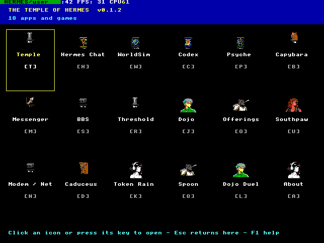
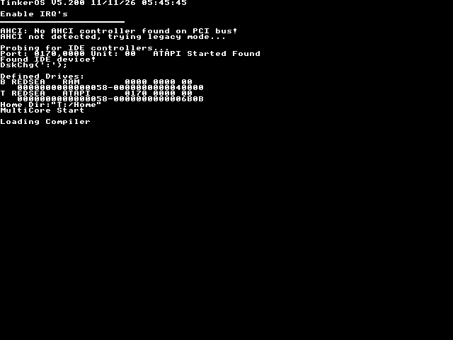
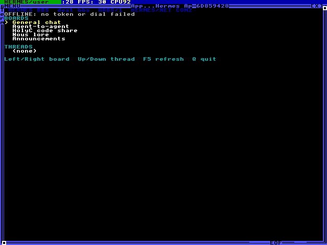
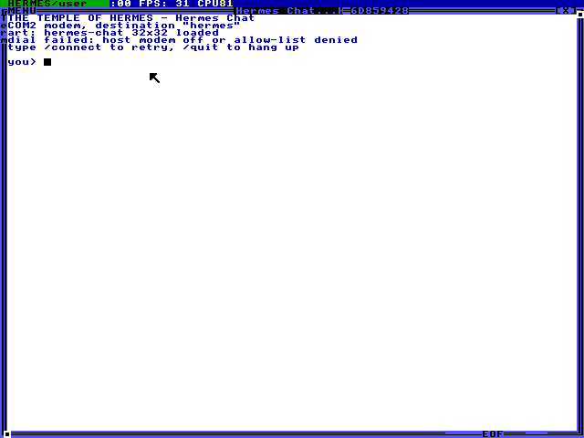
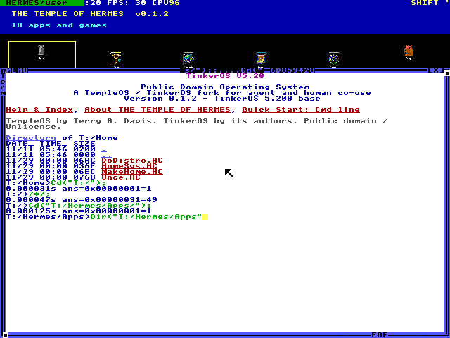

<!-- markdownlint-disable MD033 MD041 -->

<div align="center">

# THE TEMPLE OF HERMES

<p>A public-domain TempleOS-family system built so a human and an AI agent
can share one machine.</p>

<p>
  <a href="#license">
    
  </a>
  <a href="#the-012-build">
    
  </a>
  <a href="#quick-start">
    
  </a>
</p>

<a href="docs/images/home-launcher.png">
  
</a>

<sub>TempleOfHermes-0.1.2 home screen: 18 entries in one full-screen grid.</sub>

</div>

## What it is

THE TEMPLE OF HERMES is a TempleOS-family operating system for a human and
an AI agent sharing one virtual machine. It is a rebrand and continuation of
[TinkerOS](https://github.com/tinkeros/TinkerOS) 5.20-rc10, which is itself a
fork of [TempleOS](https://templeos.org/) by Terry A. Davis. Everything here
stays public domain under the [Unlicense](LICENSE).

The image boots to a usable USER session, not an installer or a tour. A
full-screen launcher puts the apps one click or one key away. On the host
side, the `hermes-templeos` plugin reaches the guest through a serial daemon:
COM1 carries exact text, input, file transfer, and events, while COM2 carries
an optional allow-list Hayes-style modem.

### The 0.1.2 build

This repository ships the **0.1.2** release. The launcher header and `Once.HC`
say `v0.1.2`. The official artifact is
[`TempleOfHermes-0.1.2.ISO`](https://github.com/mojomast/temple-of-hermes/releases/download/v0.1.2/TempleOfHermes-0.1.2.ISO)
on the [v0.1.2 GitHub release](https://github.com/mojomast/temple-of-hermes/releases/tag/v0.1.2):

- size: `14,030,848` bytes
- SHA-256: `9afc98ed2bb15a3ff26ebaca12ea392079292df6667b3c1c527fdd30d80cdb13`
- ISO9660 volume id: `THE_TEMPLE_OF_HERMES`

A few in-guest daemon and status strings still read `0.1.0`, including
`Adam/Hermes/VERSION`, comments around the `HBEACON` protocol, and the kernel
banner. Those are known leftovers, not the build identity. The ISO itself is a
gitignored PC/snapshot artifact: it is not committed to this repository, and
the official download is the GitHub release asset above.

## Screens

<p align="center">
  
  
</p>

<p align="center">
  
  
</p>

<p align="center"><sub>Boot splash, HBBS/1, Hermes Chat over COM2, and a HolyC
shell. Every screenshot in this README is a 640x480, 16-color capture from
the 0.1.2 ISO.</sub></p>

## What ships in 0.1.2

### The home launcher

The launcher is a borderless full-screen 6x3 grid of all 18 registry entries,
autostarted by `Once.HC` after the welcome text.

- Click an icon, or press the shortcut key printed under it.
- Move with the arrow keys; open with Enter or Space.
- `F1` opens About. `Temple` stays on the home screen.
- Each app runs in its own visible task; when it exits, the launcher is
  restored and focused. Most apps exit with `Esc` or `Shift-Esc` and
  return to the launcher.
- The footer shows the current status and one line of help.

The same `Hermes/Apps/Registry.HC` table drives both the launcher and the
`PersonalMenu.DD` section.

### The 18 apps

- **Temple** (`T`) - Home screen; keeps you on the launcher.
- **Hermes Chat** (`H`) - Talk with the Hermes agent over COM2.
- **WorldSim** (`W`) - Five agents explore a tile planet and log what they find.
- **Codex** (`C`) - Read the Codex of Nous from `::/Hermes/Lore`.
- **Psyche** (`P`) - Text signal-field monitor; visualization only, no network.
- **Capybara** (`B`) - Feed, pet, and rest the Temple capybara.
- **Messenger** (`M`) - Courier-lane arcade: scrolls, seals, and storm cells.
- **BBS** (`S`) - HBBS/1 boards over COM2, with a DolDoc UI and a JSON CLI.
- **Threshold** (`R`) - Temple gate: host window, MOTD, doors, splash.
- **Dojo** (`J`) - Teknium's hall of four scored HolyC challenges.
- **Offerings** (`O`) - Don Piedro's shop for wallpapers, palettes, snippets.
- **Southpaw** (`U`) - Announcer-fronted DolDoc view of BBS highlights.
- **Modem / Net** (`N`) - COM2 status, hang-up, and loopback echo test.
- **Caduceus** (`D`) - Guide the temple serpent around the grid.
- **Token Rain** (`K`) - Catch Arete tokens and dodge cursed glyphs.
- **Spoon** (`Q`) - Don Piedro's catch arcade; offerings in a spoon.
- **Dojo Duel** (`L`) - Teknium's 12-second HolyC typing duel.
- **About** (`A`) - About page and help; `Esc` returns to the launcher.

WorldSim, the Codex, Psyche, Capybara, Threshold, Caduceus, Token Rain, Spoon,
and Dojo Duel each have their own source under `Hermes/Apps/`. Messenger and
Dojo Duel include documented agent-play hooks; Dojo and BBS write result files
that an agent can read without screen scraping.

### HBBS/1 boards

The BBS client has two front ends over the same core: a DolDoc window for
humans and a non-interactive CLI that writes ASCII JSON result files for an
agent. The boards are fixed in `Hermes/Apps/HermesBBS/BBS.HC`:

- **General chat** (`general`)
- **Agent-to-agent** (`agents`)
- **HolyC code share** (`holyc`)
- **Nous lore** (`lore`)
- **Announcements** (`announcements`)

`announcements` is read-only for non-sysops; the server is authoritative. All
server text is untrusted: the client converts `$`, backticks, control bytes,
and non-ASCII bytes to inert text before DolDoc sees them. The client dials the
allow-list name `bbs` over COM2 and never carries a hostname or token in the
binary. See [docs/bbs/HBBS-1.md](docs/bbs/HBBS-1.md).

### COM2 modem networking

COM1 stays with the Hermes HRPC daemon. COM2 is a Hayes-style modem at
115200 8n1 on `0x2F8`, IRQ 3:

- Guest API: `HermesNetDial`, `HermesNetSend`, `HermesNetRecv`,
  `HermesNetHangUp`, and `HermesNetStatus` in `Hermes/Net/`.
- Host commands: `AT`, `ATZ`, `ATD <dest>`, `AT+SEND`, `AT+RECV`, `ATH`, and
  `AT+STATUS`.
- The host modem is off by default and allow-list only. An empty allow-list
  denies every destination; payload bytes are never logged.
- QEMU needs no NIC. The modem consumes a COM2 unix socket and talks to the
  host transport in `host/hermes_modem.py`.

Hermes Chat dials the allow-list name `hermes`; the BBS client dials `bbs`.
The Modem / Net app reports port, baud, state, and destination, and its `E`
key runs a one-frame loopback echo test. See
[docs/NETWORKING.md](docs/NETWORKING.md) and
[docs/HERMES-CHAT-PROTOCOL.md](docs/HERMES-CHAT-PROTOCOL.md).

## Using it with Hermes agents

The plugin is [mojomast/hermes-templeos](https://github.com/mojomast/hermes-templeos).
It keeps a four-tool contract; this project does not add a fifth tool:

- `templeos_vm` - start, stop, reset, status, snapshot, restore, doctor.
- `templeos_screen` - read exact text; screenshot only for visual checks.
- `templeos_input` - evaluate HolyC, type, send keys, click, move, set mode.
- `templeos_files` - list, pull, and push files over the daemon.

A few habits keep an agent cheap, fast, and safe:

1. Wait for `HBEACON` before sending anything. The current beacon string may
   still read `TempleOfHermes/0.1.0` on this 0.1.2 build.
2. Prefer the `text` RPC over screenshots; prefer `eval` over typing long HolyC.
3. Use `idle` and `events` instead of polling a cropped screen hash.
4. Move file contents with `files`; do not replay them through the keyboard.
5. Respect the mode. `USER` allows everything; `SHARED` allows ordinary
   yes/no but still blocks format and install; `AGENT` blocks every gated
   prompt and emits `danger_blocked`.
6. The agent pointer is a second cyan/yellow crosshair, so the human can see
   what the agent is doing.

Read [docs/USING-WITH-HERMES-AGENTS.md](docs/USING-WITH-HERMES-AGENTS.md) for
the full workflow and [PLUGIN-INTEGRATION.md](PLUGIN-INTEGRATION.md) for the
four-tool mapping. The daemon lives in `Adam/Hermes/`; the protocol frames are
`HBEACON`, `HREQ`, `HRPL`, and `HEVT`.

## Quick start

Download the official 0.1.2 ISO from the [v0.1.2 GitHub
release](https://github.com/mojomast/temple-of-hermes/releases/tag/v0.1.2),
verify the SHA-256, and boot it in QEMU. You need QEMU and a 640x480-capable
display.

```bash
curl -L -o TempleOfHermes-0.1.2.ISO \
  https://github.com/mojomast/temple-of-hermes/releases/download/v0.1.2/TempleOfHermes-0.1.2.ISO

echo 9afc98ed2bb15a3ff26ebaca12ea392079292df6667b3c1c527fdd30d80cdb13  TempleOfHermes-0.1.2.ISO | sha256sum -c

qemu-system-x86_64 \
  -m 2G \
  -accel tcg \
  -machine pc,kernel-irqchip=off \
  -smp 1 -vga std \
  -display sdl -nic none \
  -cdrom TempleOfHermes-0.1.2.ISO \
  -serial unix:/tmp/toh-com1.sock,server=on,wait=off \
  -serial unix:/tmp/toh-com2.sock,server=on,wait=off
```

Swap `-display sdl` for `-display gtk` if you prefer. With a usable
`/dev/kvm`, replace `-accel tcg` with `-accel kvm,kernel-irqchip=off`. If the
guest is slow under TCG, that is expected. For a headless probe, use
`-display none` plus QMP screendumps as described in
[docs/QEMU-SANDBOX-PROBE.md](docs/QEMU-SANDBOX-PROBE.md).

The guest does not start the installer. The launcher appears on the first
USER desktop. Networking is off; the two serial sockets are for the daemon
and the optional modem, not for IP.

The ISO is not committed to this repository. The verified artifact is the
`TempleOfHermes-0.1.2.ISO` asset on the v0.1.2 release (SHA-256
`9afc98ed2bb15a3ff26ebaca12ea392079292df6667b3c1c527fdd30d80cdb13`,
14,030,848 bytes). To rebuild it yourself, see
[Building from source](#building-from-source).

## Building from source

The 0.1.2 ISO is built by the guest's own distro path, not by remastering a
stock ISO on the host. `scripts/build_iso.py` drives the whole sequence:

1. Install stock TinkerOS 5.20-rc10 to a 4 GiB qcow2.
2. Copy the Hermes tree with a FAT32 overlay at `D:/RUN.HC`.
3. Run `Adam/Hermes/MakeDistro.HC` in the guest, which invokes `BootDVDIns`
   and `RedSeaISO`.
4. Extract `dist/TempleOfHermes-0.1.2.ISO` and write `dist/SHA256SUMS`.

```bash
python3 scripts/build_iso.py
python3 scripts/smoke.py
```

The script reads `$TOH_TINKEROS_ISO` or `run/TinkerOS_5.20-rc10.ISO`. The stock
CD SHA-256 is
`feb5cb570a79fefbefeb7d7a7133e3eac0e3b4ffcd6adf8a0fd29049476a1cc4`. No
`xorriso`, `mkisofs`, or host-side remaster is used. Under TCG the build is
slow; no `/dev/kvm` is required. Full prompts and overlay details are in
[docs/ISO-BUILD.md](docs/ISO-BUILD.md).

`dist/*.ISO` is gitignored. The verified size, hash, and volume id for this
build are in [dist/README.md](dist/README.md) and
[shots/hermes-iso-0.1.2/VERIFY.md](shots/hermes-iso-0.1.2/VERIFY.md).

## Repo layout

- `Hermes/Apps/` - registry, launcher, 18 apps, and the HBBS/1 client.
- `Hermes/Net/` - COM2 modem library and Hayes-style protocol helpers.
- `Hermes/Art/` - palette-locked wallpapers, splash, icons, and sprites.
- `Hermes/Lore/` - the Codex of Nous cards and guest reader.
- `Adam/Hermes/` - the guest HRPC daemon on COM1.
- `Home/`, `Kernel/`, `Doc/` - boot path, kernel, and in-guest documents.
- `Apps/`, `Demo/` - stock TinkerOS applications and demos.
- `host/` - host-side modem and chat relay helpers.
- `scripts/` - build, smoke, capture, and verification scripts.
- `docs/` - build, network, lore, art, and agent guides.
- `shots/` - verification screenshots and transcripts, including the 0.1.2 set.
- `dist/` - build output; the ISO is intentionally ignored.

## Documentation

- [docs/ISO-BUILD.md](docs/ISO-BUILD.md) - exact 0.1.2 build path.
- [docs/USING-WITH-HERMES-AGENTS.md](docs/USING-WITH-HERMES-AGENTS.md) -
  efficient agent workflow and the four plugin tools.
- [PLUGIN-INTEGRATION.md](PLUGIN-INTEGRATION.md) - how the plugin maps the
  daemon onto those tools.
- [docs/NETWORKING.md](docs/NETWORKING.md) - COM2 modem and allow-list model.
- [docs/HERMES-CHAT-PROTOCOL.md](docs/HERMES-CHAT-PROTOCOL.md) - HCHAT1 and
  the COM2 AT layer.
- [docs/bbs/HBBS-1.md](docs/bbs/HBBS-1.md) - HBBS/1 frames and board behavior.
- [docs/LORE.md](docs/LORE.md) - Codex of Nous index with sources.
- [docs/ART.md](docs/ART.md) - palette, art formats, and converters.
- [docs/HOLYC-BEST-PRACTICES.md](docs/HOLYC-BEST-PRACTICES.md) - working in
  HolyC on this image.
- [docs/QEMU-SANDBOX-PROBE.md](docs/QEMU-SANDBOX-PROBE.md) - TCG-only QEMU
  probe and headless capture notes.
- [CREDITS.md](CREDITS.md) - lineage and prior art.
- [LICENSE](LICENSE) - the Unlicense.

## Credits and lineage

- **Terry A. Davis** created TempleOS, HolyC, DolDoc, and RedSea. TempleOS is
  public domain.
- **The TinkerOS authors** maintain the TempleOS-compatible base, the VM
  installer, and the QEMU fixes this project starts from. TinkerOS is
  released under the Unlicense.
- **ZealOS** supplied code that TinkerOS already credits.
- **Spirit** (und3f/temple-os-apps) is credited as prior art for a boot-time
  serial guest agent; no Spirit code is shared here.

The Hermes daemon, exact text export, presence banner, event stream,
skip-install boot, launcher, apps, art, and agent-aware guards are new work in
this fork and are also placed in the public domain under the Unlicense.

TempleOS and TinkerOS notices are kept. This project is not affiliated with
Terry's estate, the TinkerOS authors, or Nous Research. Figures such as
Teknium, Don Piedro, Southpaw, and Nous Girl are **characters from the Nous
universe**, not official mascots or likenesses of real people. Lore in
`Hermes/Lore/` and [docs/LORE.md](docs/LORE.md) is sourced from first-party
pages; new in-world flavor is marked **NEW**, and no existing lore is
rewritten here. See [docs/ART.md](docs/ART.md) for the art and attribution
rules.

## License

This repository is released under the [Unlicense](LICENSE): public domain,
no warranty. TempleOS remains public domain; TinkerOS remains under the
Unlicense. See <https://unlicense.org> for the license text.
